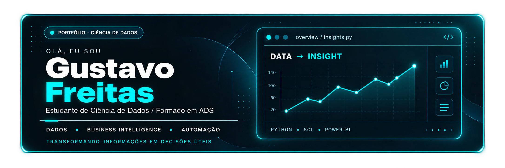
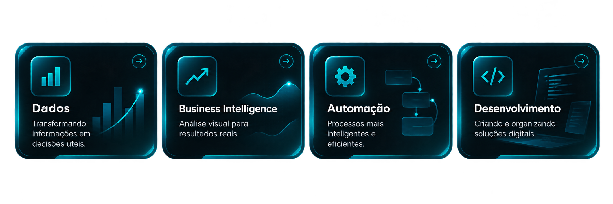
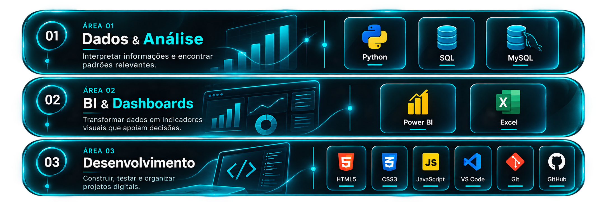

<!-- Animação com frases curtas, sem poluição visual -->

&nbsp;
&nbsp;

 <a href="#01--quem-sou-eu">SOBRE MIM</a> &nbsp; ━ &nbsp; <a href="#02--minhas-áreas-de-interesse">ÁREAS</a> &nbsp; ━ &nbsp; <a href="#03--meu-universo-de-ferramentas">FERRAMENTAS</a> &nbsp; ━ &nbsp; <a href="#04--minha-atividade-no-github">ATIVIDADE</a> &nbsp; ━ &nbsp; <a href="#05--vamos-nos-conectar">CONTATO</a> 

 

## 01 · Quem sou eu

Prazer! Sou Gustavo Freitas, formado em Análise e Desenvolvimento de Sistemas e atualmente estudante de Ciência de Dados na FATEC Rubens Lara.

Gosto de explorar informações, entender o que elas revelam e pensar em formas de transformar esse conhecimento em soluções práticas. Tenho especial interesse em análise de dados, dashboards, automação e desenvolvimento.

Minha forma de aprender: investigar, experimentar e construir projetos que façam sentido no mundo real.

📍 Baixada Santista, SP   🎓 Ciência de Dados   💻 ADS

 

## 02 · Minhas áreas de interesse

Meu interesse está na conexão entre essas áreas: entender os dados primeiro, encontrar boas formas de visualizá-los e aplicar automação e programação para resolver problemas.
 

## 03 · Meu universo de ferramentas

Ferramentas que utilizo e continuo estudando. Cada grupo representa uma etapa diferente do meu processo de aprendizado e criação.
 
## 04 · Minha atividade no GitHub

 

Os gráficos são atualizados por serviços externos a partir da atividade pública no GitHub; podem ficar temporariamente indisponíveis.

 

## 05 · Vamos nos conectar?

Estou sempre aberto a trocar ideias, aprender com outras pessoas e conhecer projetos interessantes envolvendo dados, tecnologia e automação.

&nbsp;

